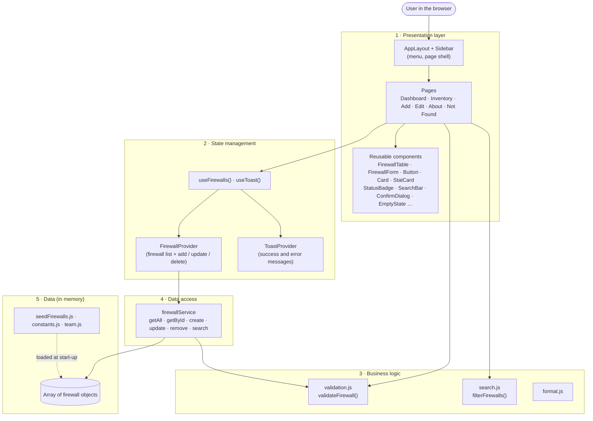
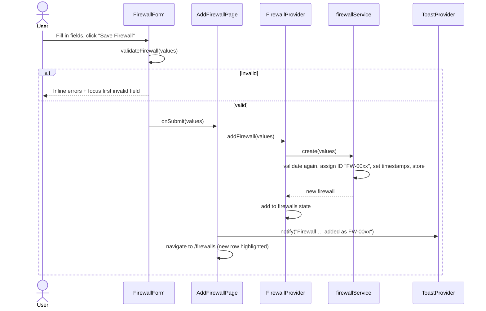

# CyberTrack — Software Architecture

| | |
|---|---|
| **Project** | CyberTrack — Firewall Asset Management System |
| **Course** | SE411 Software Engineering · Fall 2026–27 · Project Part 1 |
| **Version** | 1.0.0 · 17 October 2026 |
| **Related documents** | [Requirements Analysis](REQUIREMENTS_ANALYSIS.md) · [UI/UX Design](UI_UX_DESIGN.md) · [Technical Documentation](TECHNICAL_DOCUMENTATION.md) · [Testing Report](TESTING_REPORT.md) · [Code Review](CODE_REVIEW.md) · [README](../README.md) |

---

## 1. Overview

CyberTrack is a **single-page application (SPA)** written in React. The browser loads one HTML page once. After that, React swaps page content in and out as the user moves around, without reloading.

Part 1 is **frontend only**, as the project specification requires. There is no server, database or API. Firewall records are kept as a **collection of JavaScript objects in memory**. In Part 2 the team will write a backend by hand, and this architecture is designed so that the backend can replace the in-memory store with as few changes as possible.

### Architectural style: layered

The code is organised in **layers**. Each layer has one job and only talks to the layer directly below it.

| Layer | Responsibility | Folder(s) |
|---|---|---|
| **1. Presentation** | What the user sees: pages, layout and reusable UI components. No business rules. | `src/pages`, `src/components`, `src/styles` |
| **2. State management** | Holds the current list of firewalls and success messages, and shares them with every page. | `src/context`, `src/hooks` |
| **3. Business logic** | Rules that do not depend on React: validation, searching, formatting. Plain JavaScript functions. | `src/utils` |
| **4. Data access** | The only code that reads or changes the stored firewalls. Every method returns a Promise. | `src/services` |
| **5. Data** | Sample firewalls, allowed values (manufacturers, statuses), team information. | `src/data` |

**Why layers?** Each part can be understood, tested and replaced on its own. For example, the validation rules are tested without rendering any UI, and in Part 2 the data access layer can be swapped without touching the pages.

---

## 2. Architecture Diagram



**How to read it:** arrows show "uses". Pages never touch the stored array directly. They ask `FirewallProvider` (through the `useFirewalls()` hook), which asks `firewallService`, which owns the array.

---

## 3. Application Start-up

`src/main.jsx` builds the application by wrapping it in three **providers**. A provider is a React component that makes data available to everything inside it.

```
<StrictMode>
  <BrowserRouter>            ← routing: maps the URL to a page
    <ToastProvider>          ← success / error messages
      <FirewallProvider>     ← the shared firewall list
        <App />              ← route table (src/App.jsx)
```

When `FirewallProvider` first appears, it calls `firewallService.getAll()`. Until that Promise resolves, its `status` is `'loading'` and pages show "Loading firewalls…". Then the list is stored in React state and `status` becomes `'ready'`. In Part 1 this happens almost instantly. The loading state exists so the same code will work with a slow network in Part 2.

---

## 4. Presentation Layer — Component Organisation

### 4.1 Component tree

```
App (routes)
└── AppLayout                     page shell: skip link, mobile top bar, sidebar, <main>
    ├── Sidebar                   menu with 4 items, highlights the active page
    │   └── Logo
    └── <Outlet/>                 the current page:
        ├── DashboardPage         PageHeader, 4 × StatCard, Card (quick access)
        ├── InventoryPage         PageHeader, Card, SearchBar, FirewallTable | EmptyState, ConfirmDialog
        ├── AddFirewallPage       PageHeader, Card, FirewallForm (mode "add")
        ├── EditFirewallPage      PageHeader, Card, FirewallForm (mode "edit") | EmptyState
        ├── AboutPage             PageHeader, Card × 2, 4 × TeamMemberCard
        └── NotFoundPage          Card, EmptyState
```

### 4.2 Three kinds of component

| Kind | Folder | Knows about firewalls? | Examples |
|---|---|---|---|
| **Pages** | `src/pages` | Yes. A page reads data through hooks, decides what to show and reacts to user actions. One page per route. | `InventoryPage`, `EditFirewallPage` |
| **Feature components** | `src/components/firewalls` | Yes, but only through props. They do not fetch or store data themselves. | `FirewallTable`, `FirewallForm` |
| **Generic UI components** | `src/components/ui`, `src/components/layout` | No. They can be reused in any application. | `Button`, `Card`, `ConfirmDialog`, `SearchBar` |

This split keeps **reusable components "dumb"**: they receive data and callbacks as props and report user actions back to the parent. Only pages connect the UI to application state.

**Example of reuse:** `FirewallForm` is one component used for both **Add** and **Edit**. The page passes `mode`, `initialValues`, a `validate` function and an `onSubmit` function. The form does not know whether it is creating or updating a record.

### 4.3 Styling

- `src/styles/tokens.css` defines every colour, font size, spacing value and breakpoint-dependent value **once**, as CSS custom properties (variables).
- Each component has its own **CSS Module** (`Button.module.css`, …). Vite gives each class a unique name, so styles from one component cannot accidentally affect another.
- No UI framework (such as Bootstrap) is used.

---

## 5. State Management

React state that several pages need is held in **Context** providers rather than passed down through many components.

| Provider | State it holds | Functions it offers | Hook |
|---|---|---|---|
| `FirewallProvider` | `firewalls` (array), `status` (`'loading'` / `'ready'` / `'error'`) | `addFirewall(data)`, `updateFirewall(id, data)`, `deleteFirewall(id)` | `useFirewalls()` |
| `ToastProvider` | list of visible messages | `notify({ type, message })` | `useToast()` |

**Local state** stays inside the component that needs it. Examples: the search text (`InventoryPage`), which firewall is waiting for delete confirmation (`InventoryPage`), form values and errors (`FirewallForm`), and whether the mobile menu is open (`AppLayout`).

**Derived values are calculated, not stored.** Dashboard counts and the filtered inventory list are computed from `firewalls` on every render (with `useMemo`). They can therefore never get out of step with the data.

---

## 6. Business Logic

These are plain JavaScript functions with no React code, so they are easy to unit-test.

| File | Function | Purpose |
|---|---|---|
| `utils/validation.js` | `validateFirewall(input, existing, currentId)` | Returns an object of `{ field: errorMessage }`; empty means valid. Checks required fields, lengths, formats, allowed values and uniqueness. |
| | `normalizeFirewall(input)` | Trims spaces from every text field. |
| | `isValidIPv4(value)` | Checks dotted-decimal IPv4 format. |
| `utils/search.js` | `filterFirewalls(list, query)` | Case-insensitive search across ID, name, manufacturer, IP and location. |
| `utils/format.js` | `formatDateTime`, `percentOf`, `initials` | Display helpers. |

**Validation runs in two places, on purpose:**
1. **In the form**, before saving, so the user gets immediate feedback.
2. **In the data service**, before storing, so data that breaks the rules is rejected even if a caller skips the form.

`validateFirewall()` also checks that every field is **text** (or missing). Any other type, such as a number, object or `true`, is rejected with the error *"Invalid value: text expected"* rather than converted. The form always sends text, so users never see this message. It protects the store from code that calls the service directly (code review finding SEC-03).

Both use the same `validateFirewall()` function, so the rules cannot differ. In Part 2 the backend should repeat these checks on the server, because frontend checks can be bypassed.

---

## 7. Data Access Layer

`src/services/firewallService.js` is the **only** module that changes the firewall collection.

```js
const service = createFirewallService(initialData);   // a "factory" function
await service.getAll();             // copy of every firewall
await service.getById('FW-0001');   // one firewall, or null
await service.create(data);         // validates, assigns ID + timestamps, stores, returns the new record
await service.update(id, data);     // validates, merges, refreshes updatedAt, returns the updated record
await service.remove(id);           // true if deleted, false if not found
await service.search(query);        // matching firewalls
```

Key design points:

| Decision | Reason |
|---|---|
| **Every method returns a Promise** (`async`) even though the data is local. | An HTTP request in Part 2 also returns a Promise, so the code that calls these methods will not need to change. |
| **Records are copied** on the way in and out. | Code outside the service cannot accidentally change stored data. |
| **Only editable fields are accepted** from callers. | `id`, `createdAt` and `updatedAt` are always set by the service. Unknown fields are ignored. |
| **Errors are typed:** `ValidationError` (with an `errors` object) and `NotFoundError`. | The form can show field-level errors from the service in the same way as its own. |
| **Factory function** (`createFirewallService`) instead of a single global. | Each automated test gets a fresh, isolated store. The app uses one shared instance, `firewallService`. |
| `FirewallProvider` accepts the service as a **prop** (`service`), defaulting to `firewallService`. | A different implementation (a test store now, an HTTP client in Part 2) can be "plugged in" without editing the provider. |

---

## 8. Data Flow

### 8.1 Reading (display)

```
firewallService.getAll() ─► FirewallProvider state ─► useFirewalls() ─► page ─► FirewallTable / StatCard
```

### 8.2 Creating a firewall (the same pattern applies to update and delete)



Because the Dashboard and Inventory both read the same `firewalls` state, **every page shows the change immediately**.

| Action | Page → Provider → Service | After success |
|---|---|---|
| Add | `addFirewall` → `create` | Toast, go to Inventory, highlight new row |
| Edit | `updateFirewall` → `update` | Toast, go to Inventory, highlight edited row |
| Delete | `deleteFirewall` → `remove` (after the user confirms in `ConfirmDialog`) | Success toast, row disappears. If the store reports the firewall was not found, an **error** toast is shown instead and the stale row is removed. If deletion throws, an error toast is shown and the row stays. |
| Search | none: `filterFirewalls()` runs in `InventoryPage` on the list already in memory | Table re-renders as the user types |

> **Note:** the service also has a `search()` method (part of the planned Part 2 interface), but the current UI filters the in-memory list directly with the same `filterFirewalls()` helper. This gives instant results without a round trip.

---

## 9. Navigation and Routing

Routing uses **React Router** (`BrowserRouter`). The URL decides which page appears inside `AppLayout`. Links change the page **without reloading the browser**, so in-memory data is kept while the user navigates.

| URL | Page | In menu? |
|---|---|---|
| `/` | `DashboardPage` | ✅ Dashboard |
| `/firewalls` | `InventoryPage` | ✅ Firewall Inventory |
| `/firewalls/new` | `AddFirewallPage` | ✅ Add Firewall |
| `/firewalls/:id/edit` | `EditFirewallPage` (`:id` is an Asset ID, e.g. `FW-0003`) | Opened from the Edit (✎) action |
| `/about` | `AboutPage` | ✅ About |
| anything else | `NotFoundPage` | — |

The route table is in `src/App.jsx`. The menu is in `src/components/layout/Sidebar.jsx`, which decides which item is **active** (highlighted, `aria-current="page"`). "Firewall Inventory" also stays active on the Edit page, because the user is still working in the inventory.

On screens narrower than 1024 px the sidebar becomes a slide-in **drawer**, opened by a menu button in a top bar (`AppLayout.jsx`).

---

## 10. In-Memory Storage

- At start-up, `createFirewallService(seedFirewalls)` copies the 10 sample firewalls from `src/data/seedFirewalls.js` into a private array inside the service.
- All create, update and delete operations change that array (and the provider's copy in React state).
- **The data lives only as long as the browser tab.** Reloading the page, opening the app in another tab or closing the browser **resets the data to the 10 sample firewalls**. Navigating between pages with the menu does **not** reset it.
- No `localStorage`, cookies or files are used. This matches the specification: *"In PART 1 of the project, the data will be defined as a collection of objects (not stored in a database)."*

---

## 11. Preparing for Part 2 (Backend)

The specification states that the backend will be coded manually in Part 2. **No backend exists yet.** The table shows which parts of the current design are ready for one and what would have to change.

| Part | Ready as-is | Change needed in Part 2 |
|---|---|---|
| Pages and components | ✅ They only use `useFirewalls()`, never the storage | None expected |
| `FirewallProvider` | ✅ Already async, has a `status` and accepts a `service` prop | Show an error message when `status` is `'error'` (pages currently treat it like an empty list) |
| `firewallService` | Interface ready: same method names, Promises, typed errors | Re-implement the method bodies with HTTP requests (e.g. `fetch`): `GET /firewalls`, `POST /firewalls`, `PUT /firewalls/{id}`, `DELETE /firewalls/{id}`. Map an HTTP 400 response to `ValidationError` and 404 to `NotFoundError` |
| ID and timestamps | Generated in one place (the service) | The backend/database should generate them instead |
| Validation | ✅ Shared function, used by form and service | Repeat the same rules on the server; keep the frontend checks for fast feedback |
| Search | Works on the loaded list | Optional: call the backend's search for very large inventories |
| Seed data | Used only to start the in-memory store | Move to the database as initial data |

Because pages never know where data comes from, the expected Part 2 change is concentrated in **`firewallService.js`** plus small error-handling additions.

---

## 12. Cross-Cutting Concerns

| Concern | How it is handled |
|---|---|
| **Accessibility** | Semantic HTML (`nav`, `main`, `table`, `fieldset`), visible labels, `aria-invalid`/`aria-describedby` on form errors, `aria-current` on the active menu item, live regions for messages and search counts, a keyboard focus trap in the delete dialog and mobile menu (the `/` search shortcut is ignored while the dialog is open), a skip link, status shown as text plus colour. Contrast ratios were **calculated** from the colour values: all text colour pairs meet WCAG AA (≥ 4.5 : 1), but the input-field border (2.56 : 1) is below the 3 : 1 guideline for form controls ([UI/UX Design §2.3](UI_UX_DESIGN.md#23-calculated-contrast)). Contrast has **not yet been measured** in a browser (see [Testing Report §7](TESTING_REPORT.md#7-manual-testing), MT-07). |
| **Responsiveness** | CSS breakpoints at 1024 px (sidebar → drawer), 900 px (secondary table columns hidden) and 640 px (table rows become cards, single-column forms). |
| **Security (frontend)** | React escapes all text it renders, and the code never uses `dangerouslySetInnerHTML` or `eval`. Inputs are validated and trimmed. The service ignores attempts to set system fields. No secrets are stored in the code. |
| **Error feedback** | Field errors inline, an error summary for two or more errors, toasts for success and failure, empty and not-found states. |
| **Quality** | 113 automated tests (see [Testing Report](TESTING_REPORT.md)), ESLint and an AI code review (see [Code Review](CODE_REVIEW.md)). |

---

## 13. Key Design Decisions

| # | Decision | Alternatives considered | Why this choice |
|---|---|---|---|
| D1 | Layered structure with a separate data service | Store the array directly inside components | Clear responsibilities; Part 2 changes stay in one file |
| D2 | React **Context** for shared state | Redux or another state library | Only one shared collection; Context is built into React, so no extra dependency is needed |
| D3 | Async (Promise-based) service in Part 1 | Synchronous functions | Same calling code works with an HTTP backend later |
| D4 | One `FirewallForm` for Add and Edit | Two separate forms | No duplicated fields or validation; consistent behaviour |
| D5 | Validation as a shared pure function | Rules written inside the form | Testable without UI; used by both form and service |
| D6 | CSS Modules + design tokens | UI framework (e.g. Bootstrap), CSS-in-JS | No extra runtime library; styles are scoped per component; colours defined once |
| D7 | Asset IDs from an always-increasing counter | "Highest existing ID + 1" | The earlier approach reused deleted IDs (found and fixed in QA, ISS-01) |
| D8 | Client-side routing with React Router | Showing/hiding pages with state | Each page has its own URL; browser back/forward work |

---

## 14. Limitations

- Data resets on page reload (in-memory storage, by design for Part 1).
- Single user and no login. Authentication is outside the Part 1 scope.
- When the app is deployed to a static web host, the host must send `index.html` for every URL (an "SPA fallback"); otherwise deep links such as `/about` return 404 on refresh. `npm run dev` and `npm run preview` already do this.
- The `'error'` state of `FirewallProvider` cannot occur in Part 1 and has no dedicated screen yet (see Section 11).
